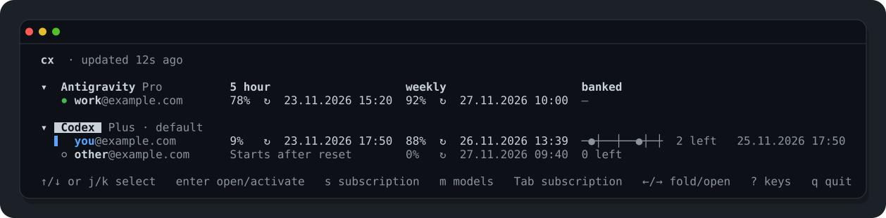

# cx

A small account switcher for Codex and Antigravity on macOS and Linux.

Switch between accounts and see live quota and reset times in one dashboard.



## Install

Install the CLI for each provider you use. Antigravity support requires `agy` 1.5.14 or later.

```sh
curl -fsSL https://raw.githubusercontent.com/ecylmz/cx/main/install.sh | sh
```

This installs `cx` to `~/.local/bin` and imports your existing Codex login as an account named `primary` (if you have one). It leaves your shell startup files alone, with one exception: Omarchy reserves `cx` for Claude Code, so on an Omarchy machine the installer appends a small block to `~/.bashrc` that drops that alias — and says so when it does.

### Shell integration (optional)

Recent Codex versions can keep a local app-server alive between sessions. While one is running, a bare `codex` may reattach to it and keep serving the account that was active when it started — so a switch you just made with `cx use` looks like it did nothing.

If you see that, add this to `~/.zshrc` or `~/.bashrc` for Zsh or Bash:

```sh
eval "$(cx shell-init)"
```

For Fish, add this to `~/.config/fish/config.fish`:

```fish
cx shell-init | source
```

When you omit the shell argument, `cx shell-init` checks the process that started it, then `$SHELL`. If neither identifies Bash, Zsh, or Fish, it uses Bash/Zsh syntax. Pass `bash`, `zsh`, or `fish` to select the output explicitly, for example `cx shell-init fish | source`.

It defines a small `codex` shell function that passes one config override, which turns that reuse off so every new session reads the account cx selected. You can also pass the override by hand on the one run where it matters, instead of keeping a wrapper around:

```sh
codex -c 'cli_auth_credentials_store="file"'
```

Each Codex account switch sets the file credential store in `~/.codex/config.toml` and repoints `auth.json`. The optional wrapper disables implicit app-server reuse.

## Use

```sh
cx              # dashboard: pick an account, see quotas
cx add work     # add another account via Codex device auth
cx use work     # activate the Codex account and make Codex the default provider
cx auto         # choose an account by available quota
cx run          # start the default provider with its active account
```

### Command reference

```sh
cx status [PROVIDER/][NAME] [--json] # show quotas for all accounts or a selection
cx current                           # show the account for cx run
cx list                              # list accounts without network access
cx rename [PROVIDER/]OLD NEW
cx remove [PROVIDER/]NAME
cx relogin NAME [--expect EMAIL]     # refresh a Codex account's credentials
cx doctor                            # report issues with the Codex CLI and credentials
cx update                            # install the latest release
cx version
```

### Dashboard

With one provider, the dashboard lists its accounts directly. With multiple providers, all groups start open and appear in alphabetical order by provider name. A green dot marks each provider's active account. The cyan bar marks the cursor.

Press `Enter` on an account to activate it for its provider. Press `←` to fold the group under the cursor. The folded heading shows its active account. Press `→` or `Enter` to open the group.

With multiple providers, use `d` to select the default provider separately. Press `d` on a provider's account or folded heading. The heading shows `default` for the provider that `cx run` launches and `cx auto` tries first. The footer can show `d set default` only while the cursor is on a folded heading. Press `?` to see all shortcuts.

### Selecting accounts from the command line

If you omit the account name from `cx use`, cx opens the account picker. Use `cx use agy/` or `cx use codex/` to limit the picker to one provider. When you confirm the choice in the picker, cx activates the account and sets its provider as the default.

If you provide an account name, cx makes both changes immediately. Add `--resume` to resume the selected account's last conversation.

Use `agy/NAME` or `codex/NAME` with `cx use`, `cx status`, `cx rename`, or `cx remove`. A plain name targets Codex. Run `cx status agy/` for all Antigravity accounts or `cx status` for all accounts.

`cx list` marks the account for `cx run` with `*`. `cx status` marks that account with a green dot. In JSON output, that account has `"active": true`.

### Antigravity

If you already use Antigravity, run `cx agy init` to register that login as `primary`. This profile uses your existing Antigravity configuration. To choose a different name, run `cx agy init NAME`.

To add another Google account:

1. In an interactive terminal, run `cx agy add work`. Use a different name for each account.
2. Open the Google sign-in URL that `agy` prints. Select the Google account you want to add.
3. If Google gives you an authorization code, paste it into the same terminal.

Each new profile has its own home directory, credentials, configuration, and conversation history.

```sh
cx list               # list registered accounts
cx use agy/work       # activate work and make Antigravity the default provider
cx use agy/           # pick an Antigravity account, then confirm to set the default
cx status agy/work    # show quota by model group
cx run                # start the default provider with its active account
```

Use `cx agy run` to start Antigravity with its active account, regardless of the default provider. Use `cx agy help` to list the Antigravity commands.

The dashboard shows one row per Antigravity model group. The columns show the remaining 5-hour and weekly quotas. A wide terminal also shows the time until reset. Run `cx status agy/NAME` for the full quota details.

### Adding the right account

If several ChatGPT accounts are signed into your browser, `--expect` is an optional safety check:

```sh
cx add work --expect you@example.com
```

cx verifies the email that device auth actually returned and refuses to save the credential if it doesn't match. It also rejects adding an account that cx already manages under another name.

### Automatic selection

`cx auto` starts with the default provider. It keeps the active account if that account qualifies. If the active account lacks usable quota, cx looks for another account from the same provider. If no account there qualifies, cx tries the other provider. If cx switches providers, the new provider becomes the default.

Codex accounts need quota left in every reported window. Antigravity accounts need quota left in every reported window of at least one model group.

For Antigravity, cx uses the usable model group with the most quota left for each account. Among the accounts that qualify, cx selects the account with the least quota left. Both comparisons use weekly quota first and 5-hour quota to break ties.

If cx cannot read an account's quota, it skips that account. If no account qualifies, cx keeps the selection and exits with status 1.

### Quota windows

The dashboard and `cx status` start unused Codex quota windows with a minimal request. This uses a few tokens. Antigravity quota reads and `cx auto` use read-only quota checks.

### Banked resets

Codex accounts with banked rate-limit resets get a third meter line. The line shows 30 days with a tick at each week. Each reset appears at its expiry date.

```
banked  ─────┼●───┼────┼────┼─       1 left   next in 8d 23h
```

The scale is the same across Codex accounts. On the active account, a pip turns yellow within a week of expiry and red within a day. A cell with more than one reset shows `◉`. The count `2 left · 1?` means that one of two resets has an unknown expiry date. Press `b` in the dashboard or run `cx status` to see the exact dates.

## Build from source

```sh
git clone https://github.com/ecylmz/cx.git
cd cx
CX_BUILD_FROM_SOURCE=1 ./install.sh
```
